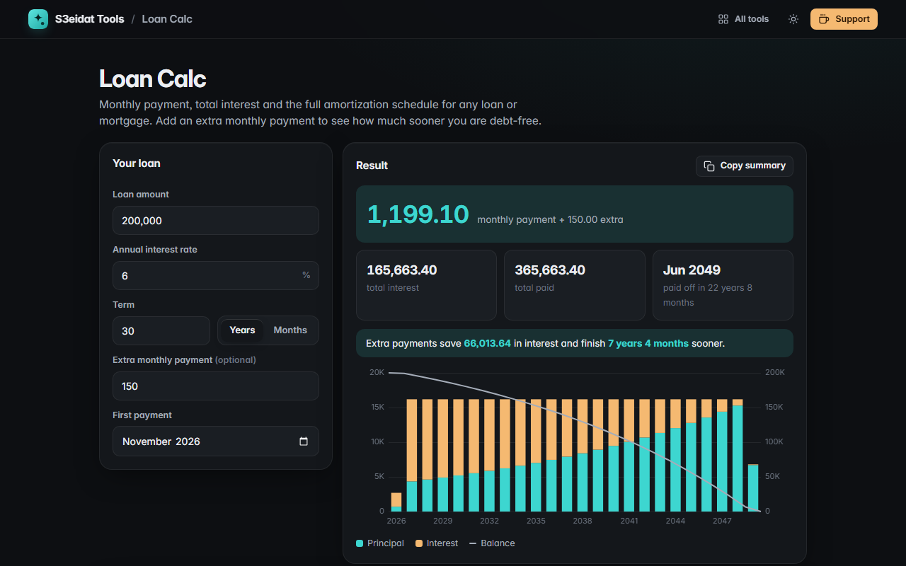

# Loan Calc

> Monthly payment, total interest, payoff date and a full amortization schedule. Free, private, and it runs entirely in your browser.

### ▶ [Open Loan Calc](https://s3eidat.github.io/loan-calc/)



## Features

- **Monthly payment** for any amount, rate and term (in years or months), including **0% loans**
- **Total interest**, **total paid** and the **payoff month**
- **Extra monthly payment**: see how much interest it saves and how many months sooner you finish
- **Amortization schedule**, yearly or monthly, with principal, extra, interest and balance per row
- **Chart** of principal vs interest per year, with the remaining balance
- Maths done in whole cents, so the schedule adds up exactly and the last payment clears the balance to 0.00
- Copy a text summary, or export the full monthly schedule as **CSV**
- Remembers your last inputs on this device

Results are estimates for a standard fixed-rate, monthly-payment loan. Your lender's figures may differ
(fees, insurance, day-count rules, rounding). This is not financial advice.

## Privacy

Your numbers never leave your device. There is no server, no account, no analytics.
The page ships with a strict Content-Security-Policy (`connect-src 'self'`), so the browser
itself blocks any attempt to send data anywhere.

## Run it yourself

It's plain HTML, CSS and JavaScript with no build step:

```bash
git clone https://github.com/s3eidat/loan-calc
cd loan-calc
python -m http.server 8000
```

Then open http://localhost:8000.

## Support

If this saved you time, **[buy me a coffee ☕](https://s3eidat.github.io/coffee/)**. It keeps every tool free.

---

Part of **[S3eidat Tools](https://s3eidat.github.io/)**: 100+ free, private tools that run in your browser. MIT licensed.
